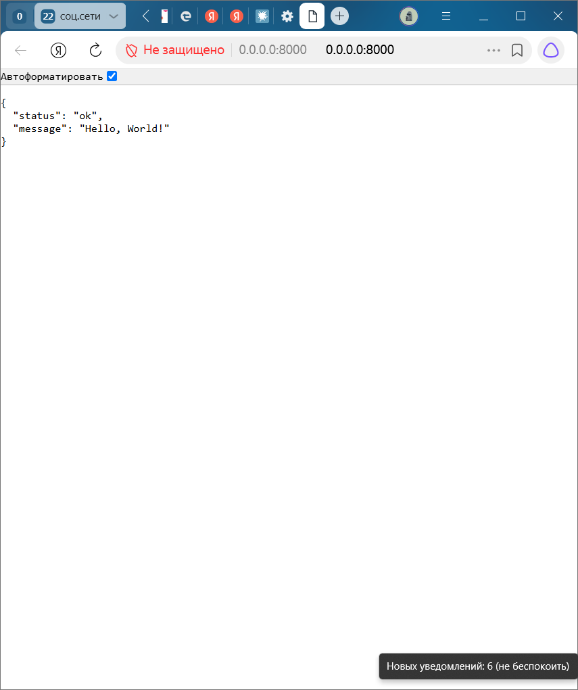

Язык: Python 3.11
Фреймворк: FastAPI, Uvicorn
Контейнеризация: Docker, Docker Compose

## Лабораторная1
Выполненные задачи:
1. настроила виртуальное окружение
2. Сoздан простейший http-сервер на FastAPI
3. Приложение контейнеризировано

