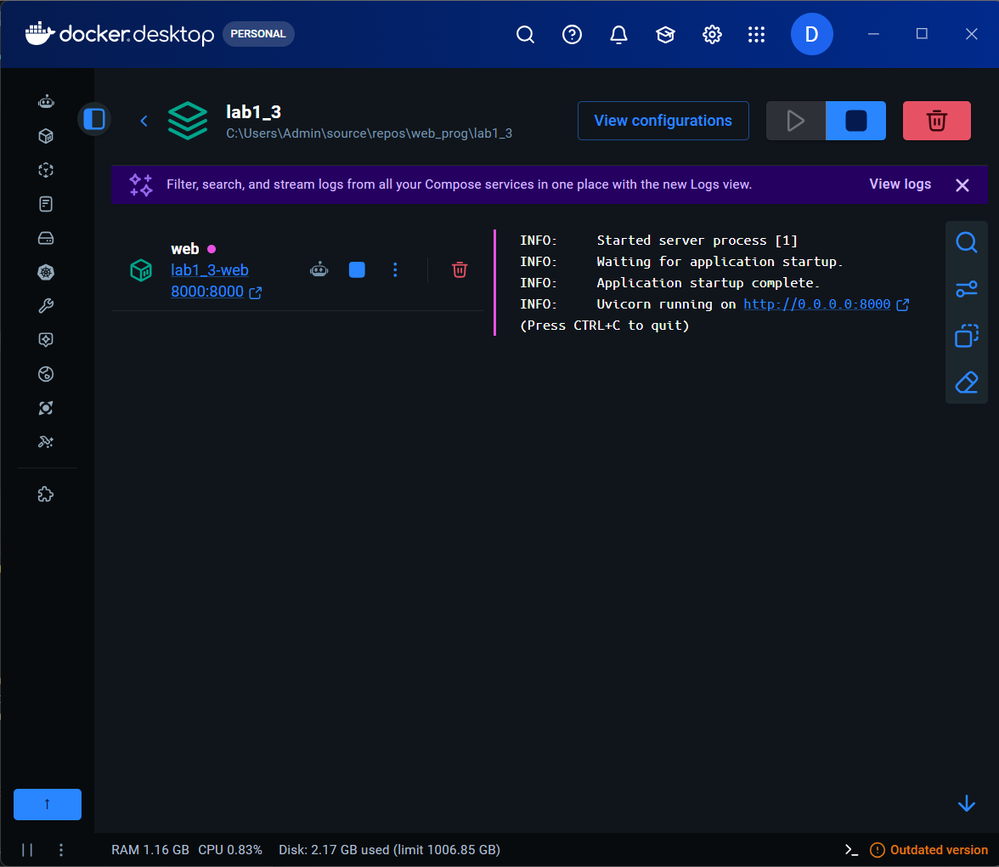
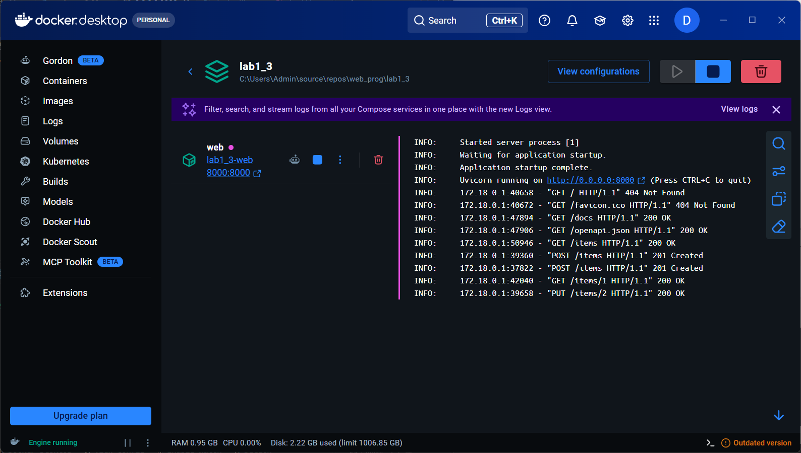
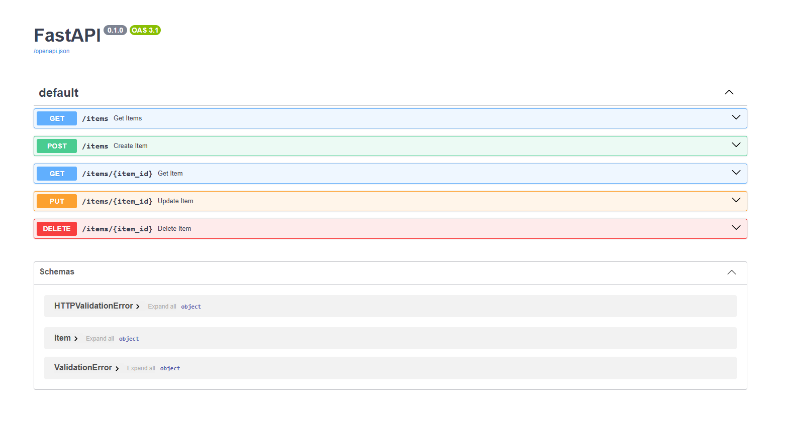
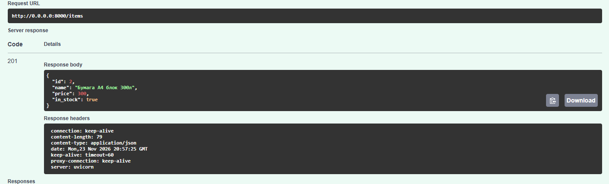
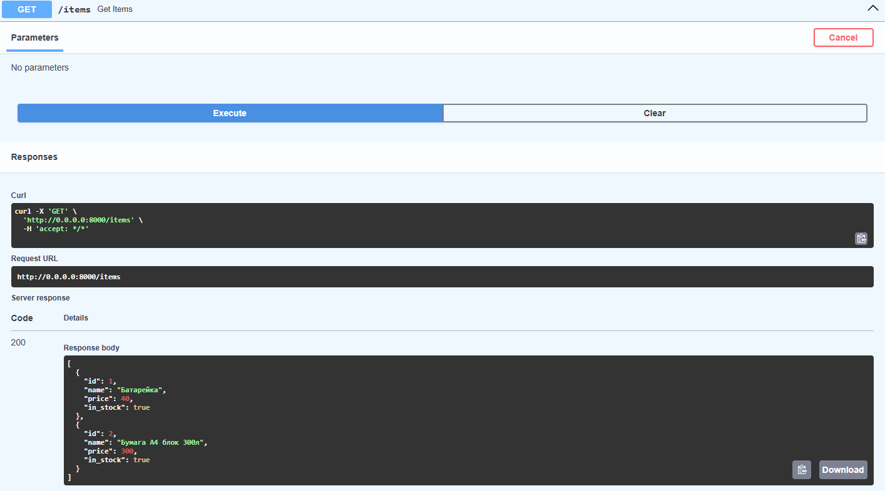
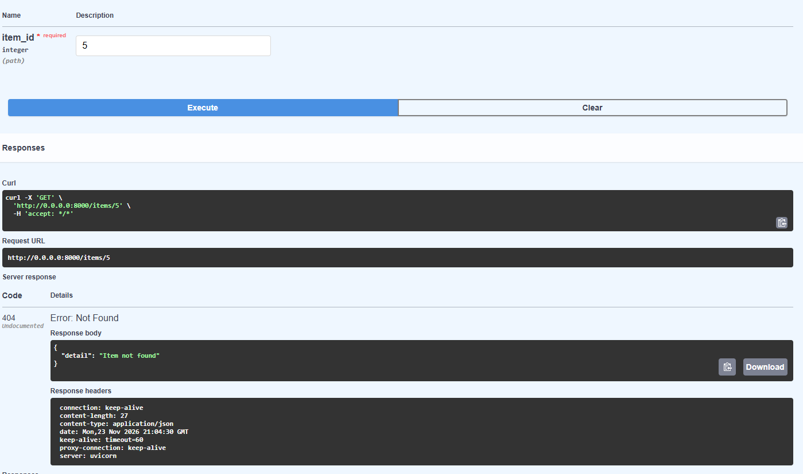

Язык: Python 3.11
Фреймворк: FastAPI, Uvicorn
Контейнеризация: Docker, Docker Compose

## Лабораторная 1
Выполненные задачи:
1. настроила виртуальное окружение
2. Сoздан простейший http-сервер на FastAPI
3. Приложение контейнеризировано

## Лабораторная 2
1. Спроектирована API для сущности Товар (Item)
2. Реализованы эндпоинты:
   * `GET /items` — получить список всех товаров.
   * `GET /items/{id}` — получить один товар по ID.
   * `POST /items` — создать новый товар.
   * `PUT /items/{id}` — обновить товар.
   * `DELETE /items/{id}` — удалить товар.

3. Использованы правильные статус-коды (201 при создании, 404 если не найдено, 204 при удалении)
4. Автоматически сгенерирована документация OpenAPI

