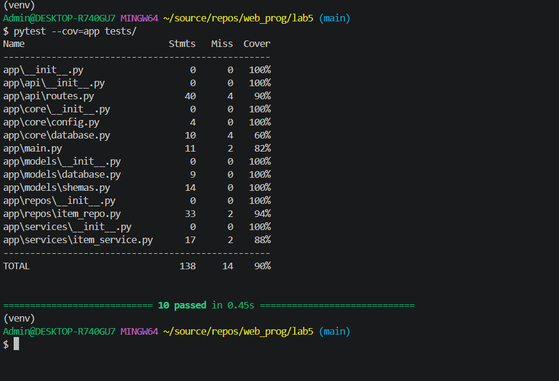

Язык: Python 3.11
Фреймворк: FastAPI, Uvicorn
Контейнеризация: Docker, Docker Compose

## Лабораторная 5

Выполненные задачи:
1. Unit-тесты для бизнес логики
- Тестирование создания продукта
- Тестирование обработки ошибки "Продукт не найден"
- Использование "MagicMock" для изоляции от бд
(тестирую логику)

2. Integration-тесты
- Проверка эндпоинта "/"
- Создание продукта
- Валидация: отрицательная цена
- Бизнес-правило: название из цифр
- Получение несуществующего ID

3. Тестовое окружение
- Настроен conftest.py с использованием SQLite in-memory
- Таблицы создаются перед каждым тестом и удаляются после (изоляция)

Для подавления предупреждений сторонних библиотек настроен файл pytest.ini

