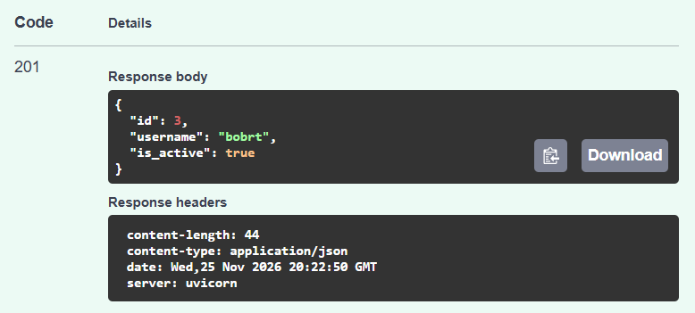
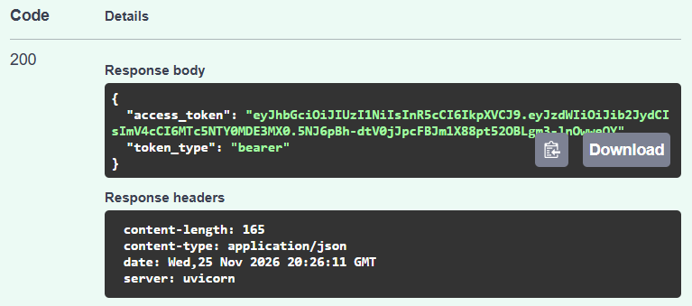
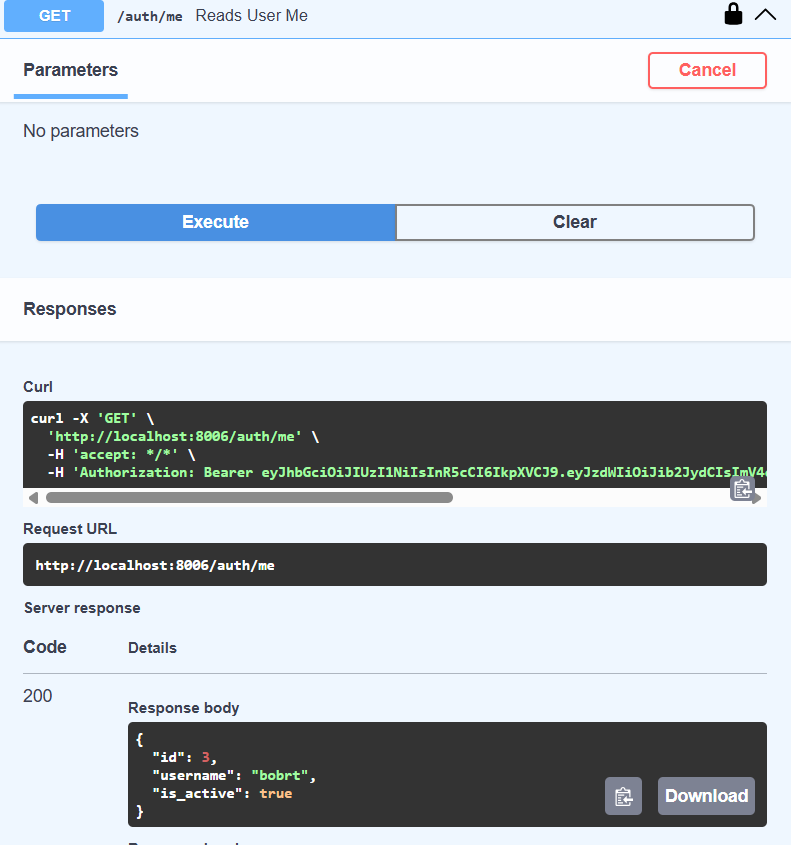

Язык: Python 3.11
Фреймворк: FastAPI, Uvicorn
Контейнеризация: Docker, Docker Compose

## Лабораторная 6

Выполненные задачи:
1. JWT-аутентификация: Реализованы эндпоинты `/auth/register` и `/auth/login`. Пароли хэшируются с помощью `bcrypt`.
2. Защищенные роуты: Эндпоинт `/auth/me` возвращает профиль текущего пользователя. Доступ к нему возможен только с валидным JWT-токеном.
3. Миграции БД: Настроен Alembic. Создана миграция для таблицы `users`, которая применяется командой `alembic upgrade head`.
4. Параметризованные запросы: Все запросы к БД через SQLAlchemy используют параметризацию, что защищает от SQL-инъекций.

### Скриншоты:

### Как проверить:
1. Зарегистрируйте пользователя через `POST /auth/register`.
2. Выполните вход через `POST /auth/login`, скопируйте `access_token`.
3. Нажмите кнопку Authorize в Swagger и вставьте токен.
4. Проверьте `GET /auth/me` — должен вернуться профиль пользователя.

